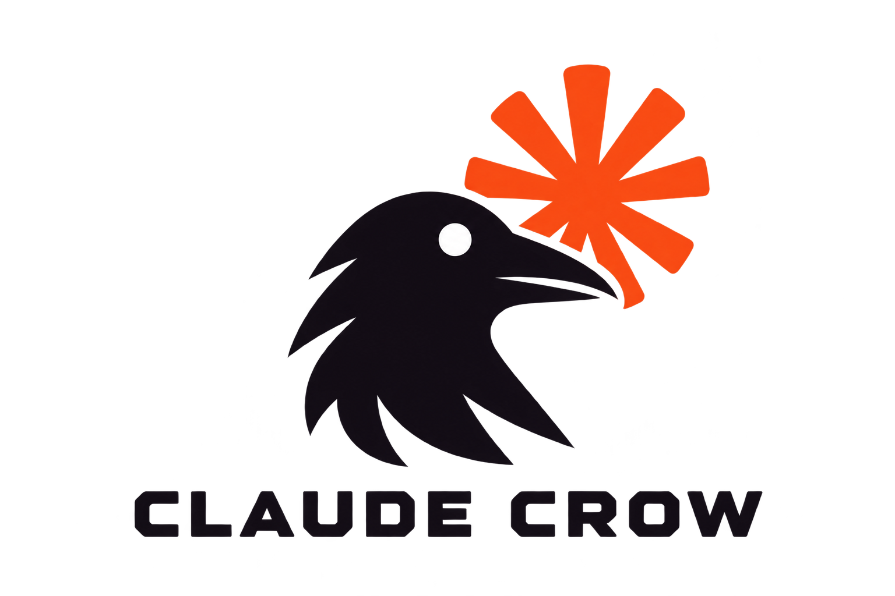

<p align="center">
  
</p>

# claude-crow

Plugin `crow` do Claude Code: as minhas skills num lugar só. Cada skill vira um
comando com o prefixo do plugin.

**Autor:** Caique Rechi Mehret

| Comando | Skill | Quando roda |
| --- | --- | --- |
| `/crow:context` | prepara o projeto para continuar em outro modelo, ferramenta ou chat | só quando eu chamo — e é a primeira a rodar num projeto |
| `/crow:conventions` | as minhas convenções de trabalho | sozinha, sempre que o agente for escrever código, criar branch ou commitar |
| `/crow:analyst` | analista de requisitos | só quando eu chamo |
| `/crow:develop` | codifica o que o analyst documentou, fase por fase | só quando eu chamo |
| `/crow:build` | sobe o projeto num ambiente Docker local para eu testar | só quando eu chamo |
| `/crow:security-validation` | analista de segurança defensiva | só quando eu chamo |

A ordem num projeto novo: `context` → `analyst` → `develop` → `build` →
`security-validation`. A `conventions` vale o tempo todo.

Skill nova entra em `skills/<nome>/SKILL.md` e vira `/crow:<nome>`. O nome da
pasta tem de bater com o `name:` do frontmatter: quando divergem, a skill
simplesmente não carrega e não dá erro nenhum. Todo nome é em inglês.

Toda skill carrega o mesmo bloco de **regras inegociáveis**, de
[.github/non-negotiable-rules.md](.github/non-negotiable-rules.md): subagente só
quando eu pedir explicitamente; nunca apagar trabalho para recomeçar do zero nem
afirmar o que não foi visto; perguntar antes de qualquer dúvida que mude a
arquitetura ou fuja de uma regra documentada; nunca commit com coautoria. O
pacote de release recusa uma skill sem o bloco ou com nome fora do padrão.

## context

Prepara o projeto para que o trabalho sobreviva ao fim de uma sessão: cria só
os arquivos que faltam entre `CLAUDE.md`, `AGENTS.md`, `GEMINI.md`,
`CONTEXT.md`, `ARCHITECTURE.md`, `TASKS.md` e `.context/`, mantém tudo fora do
git, e salva ou retoma o ponto exato onde parei. Agentes de ferramentas
diferentes deixam recado uns para os outros por arquivo.

```
/crow:context
/crow:context save
/crow:context resume
```

Como funciona: [docs/context.md](docs/context.md).

## conventions

As decisões que eu já tomei e não quero repetir a cada sessão. Valem para
qualquer projeto meu, e não descrevem sistema nenhum em específico.

| Assunto | Regra |
| --- | --- |
| Commits | um por alteração, em inglês, com prefixo convencional e sem co-autoria |
| Erro já commitado | corrigido em commit novo; reescrever só quando eu pedir |
| Branch | uma por tarefa, a partir da `main`, no padrão `cm-titulo-resumido` |
| Push | meu, sempre — o agente para no commit |
| Testes | tudo testado; no mesmo commit quando é desenvolvimento, separado quando é alteração não-trivial |
| Documentação | sem ela o trabalho não está pronto, e vai sempre num commit `docs:` próprio |
| Comentários | só o necessário, e em inglês |
| Nomes | `camelCase` no código, `PascalCase` em classe, `snake_case` no banco |
| Migration | sempre reversível, e o `down()` rodado |
| Design | Clean Code e SOLID sempre, sem abstração para um caso só |
| Segurança | toda alteração checada contra bot criando registro, XSS e dado sensível exposto |
| Desempenho | cache onde o dado permitir; navegador e servidor escolhidos de propósito |
| Subagentes | só quando eu pedir |
| Discordância | falar antes de fazer, nunca depois |
| Hooks | não se pula, nem com `--no-verify` |

O detalhe e o **porquê** de cada uma estão em
[skills/conventions/SKILL.md](skills/conventions/SKILL.md). O porquê é a parte
que importa: sem ele a letra é cumprida e a intenção se perde no primeiro caso
que não estava previsto.

## analyst

Faz o levantamento de requisitos de uma solicitação, uma pergunta por vez, até
cobrir 100% de uma checklist de dezesseis áreas — de modelo de negócio a aceite.
No fim escreve a documentação completa da solução em `docs/requirements/` do
projeto: regras de negócio, requisitos, modelo de dados, arquitetura, fluxos,
riscos e decisões em aberto.

```
/crow:analyst sistema de agendamento de entregas
```

Como usar, o que ela pergunta e o que entrega: [docs/analyst.md](docs/analyst.md).

## develop

Pega o documento de `docs/requirements/` e constrói uma fase por vez, MVP
primeiro: cada requisito vira código com um teste por critério de aceite,
commits nas minhas convenções e um registro de rastreabilidade ligando cada
requisito a arquivos, testes e commit. Para no fim de cada fase. Sem documento,
não começa; documento contraditório, pergunta.

```
/crow:develop
```

Detalhes: [docs/develop.md](docs/develop.md).

## build

Sobe o projeto na minha máquina com Docker Compose: banco, migrations, dados e
contas de teste, portas só em `127.0.0.1`, e a URL conferida antes de entregar.
Só local, nunca publica nada.

```
/crow:build
/crow:build status
/crow:build down
```

Detalhes: [docs/build.md](docs/build.md).

## security-validation

Validação de segurança defensiva com 41 regras — as 24 obrigatórias da minha
especificação e 17 para os ataques que elas não cobrem —, referências OWASP,
CWE e MITRE conferidas nas fontes oficiais, testes dinâmicos só com
autorização, e um relatório em `docs/security/` que diz o que foi verificado,
como, e o que ficou de fora. Nunca afirma que o sistema está livre de
vulnerabilidades.

```
/crow:security-validation API de pedidos
```

Como usar, as regras e onde ela se afasta da especificação:
[docs/security-validation.md](docs/security-validation.md).

## Instalação

O repositório é ao mesmo tempo o plugin e um marketplace com ele dentro. Dentro
do Claude Code:

```
/plugin marketplace add CaiqueRechi/claude-crow
/plugin install crow@claude-crow
```

Ou pelo terminal:

```bash
claude plugin marketplace add CaiqueRechi/claude-crow
```

```bash
claude plugin install crow@claude-crow
```

Os nomes: o repositório e o marketplace são `claude-crow`, o plugin é `crow`.

Para usar um clone local em vez do GitHub — útil enquanto uma skill está sendo
escrita — passe o caminho da pasta no lugar de `CaiqueRechi/claude-crow`.
Para testar sem instalar, `claude --plugin-dir <caminho do clone>` carrega o
plugin só naquela sessão.

### Vindo do marketplace rm-skill-claude

Até o `crow` 1.1.0 o marketplace se chamava `rm-skill-claude`, e o plugin era
instalado como `crow@rm-skill-claude`. Para continuar recebendo atualizações,
troque o marketplace uma vez:

```bash
claude plugin marketplace remove rm-skill-claude
```

```bash
claude plugin marketplace add CaiqueRechi/claude-crow
```

```bash
claude plugin install crow@claude-crow
```

### Vindo do rm-skill-claude 1.x

Até a 1.1.0, antes de virar o plugin `crow`, a skill era clonada direto em `~/.claude/skills/rm-skill-claude`.
Apague essa pasta depois de instalar o plugin: nesse formato ela não carrega
mais, e se for atualizada por `git pull` volta a carregar a versão antiga.

### Instalação por release

As [Releases](https://github.com/CaiqueRechi/claude-crow/releases) oferecem
um ZIP do plugin e o respectivo checksum SHA-256. Baixe os dois arquivos da
versão desejada, valide o checksum, extraia o ZIP onde quiser e adicione a
pasta `crow` extraída como marketplace.

No Linux:

```bash
sha256sum -c crow-v1.0.0.zip.sha256
unzip crow-v1.0.0.zip -d ~/plugins
claude plugin marketplace add ~/plugins/crow
claude plugin install crow@claude-crow
```

No PowerShell, compare o resultado abaixo com o valor presente no arquivo
`.sha256` antes de extrair:

```powershell
Get-FileHash .\crow-v1.0.0.zip -Algorithm SHA256
Expand-Archive .\crow-v1.0.0.zip -DestinationPath "$HOME\plugins"
claude plugin marketplace add "$HOME\plugins\crow"
claude plugin install crow@claude-crow
```

## Releases

A versão a publicar fica em [VERSION](VERSION) e segue versionamento semântico.
O `version` de [.claude-plugin/plugin.json](.claude-plugin/plugin.json) tem de
ser o mesmo — é ele que o Claude Code lê para saber se há atualização — e o
pacote falha se os dois divergirem.

Todo pull request roda os testes e valida a estrutura e a criação do ZIP. Quando uma alteração
entra na `main` com uma versão ainda não publicada, o workflow cria
automaticamente:

- a tag `crow-vX.Y.Z`;
- a Release com notas geradas a partir dos commits;
- o pacote `crow-vX.Y.Z.zip`;
- o checksum `crow-vX.Y.Z.zip.sha256`.

As tags `v1.0.0`, `v1.0.1` e `v1.1.0` são da skill avulsa, antes de virar o
plugin `crow`; por isso as releases do `crow` usam o prefixo `crow-`.

Depois de uma versão publicada, a próxima alteração que deva gerar Release
precisa atualizar `VERSION` e `plugin.json` juntos.

## Verificação

[docs/testing.md](docs/testing.md) registra como cada skill foi testada e o que
ficou de fora. Os cenários de cada skill estão em `evals/`.

Os testes do repositório rodam com Node.js:

```bash
npm ci
```

```bash
npm test
```

Eles verificam os nomes das skills e todo o catálogo da `security-validation`:
contrato das regras, identificadores, categorias, referências verificadas e
casos do projeto de teste. Nada disso entra no pacote de release.

## O que entra aqui

Skill minha, para uso em qualquer projeto. Nas convenções, só preferência dita
por mim.

Regra deduzida da leitura de um código é palpite, e palpite aqui se propaga para
todo projeto que eu abrir. Detalhe de uma base específica não é assunto deste
plugin — é do `CLAUDE.md` ou do `AGENTS.md` daquele repositório.
