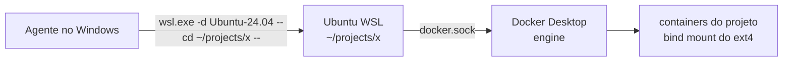
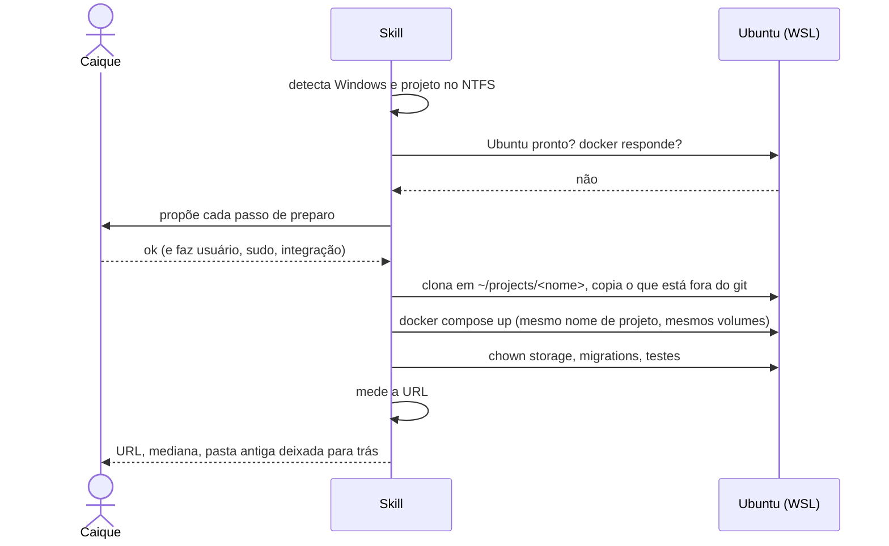
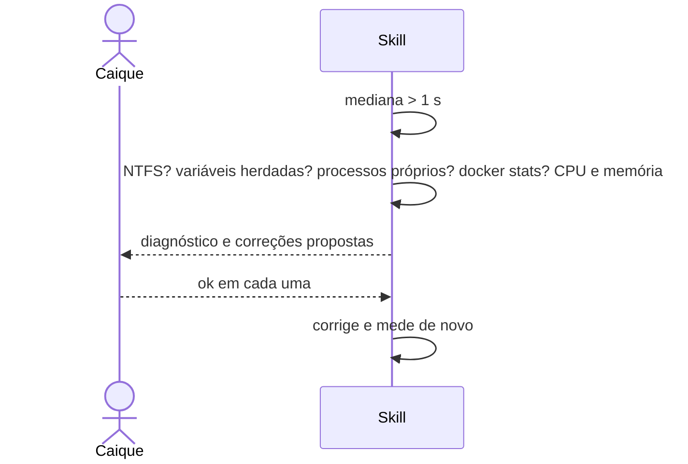

# build no WSL e correção de lentidão

| | |
| --- | --- |
| Data | 2026-10-20 |
| Solicitante | Caique Rechi Mehret (pede, aprova e dá o aceite) |
| Cobertura do levantamento | 100% — 0 decisões em aberto |
| Status | Levantamento concluído |

## 1. Resumo

O relatório "Ambiente de desenvolvimento da Engenharia: Docker no WSL e
correção da lentidão" (Hub Ibiporã, 2026-10-19) mostrou que um projeto no NTFS,
lido pelo Docker Desktop através de bind mount, fica lento a ponto de não ser
usável. O `/login` levava de 4 a 18 s, contra ~0,05 s depois que o projeto foi
para dentro do Ubuntu do WSL, e a suíte passou de mais de 1 h para 473 s. A
skill `build` passa a aplicar o que vale para qualquer projeto: no Windows, todo
ambiente roda de dentro do WSL; um projeto que ainda está no NTFS é migrado no
`up`; uma URL lenta dispara um diagnóstico; e o Docker Desktop ganha regras de
proteção e um roteiro de recuperação. O que é só do Hub (nomes, portas, contas,
`dllhost.exe`, `SESSION_ENCRYPT`) fica de fora.

### 1.1 Objetivos

- **Ambiente rápido no Windows.** Métrica: a mediana do tempo de resposta da
  URL na conferência final. Meta: até 1 s.
- **Migração sem perda.** Métrica: volumes e banco presentes depois da
  migração. Meta: os mesmos volumes, com os dados.
- **Nenhum dano ao Docker Desktop.** Métrica: uso de *Clean/Purge*, *Reset* ou
  desinstalação. Meta: zero.

### 1.2 Situação atual

- `skills/build/SKILL.md` sobe o ambiente onde o projeto estiver; no Windows,
  isso é o NTFS.
- `skills/build/references/stacks.md` diz que bind mount lento no Windows é
  esperado e não justifica mudar a disposição. **Essa linha sai.**
- A skill proíbe mudar configuração do Docker Desktop e tocar containers de
  outros projetos, e pede que ele abra o Docker quando o daemon não responde.
- O template PHP/Laravel não tem Node na imagem do app, nem passo de permissão
  de `storage/`.
- Preservar: as regras de segurança do ambiente local (portas em `127.0.0.1`,
  imagens com versão fixa, segredos só no `.env`, um projeto Compose por
  projeto), o "cria só o que falta" e o "nunca sobrescreve".

## 2. Partes interessadas e usuários

| Persona | Quantidade | Precisa de | Pode | Não pode |
| --- | --- | --- | --- | --- |
| Caique | 1 | ambiente local rápido no Windows | aprovar cada passo de preparo do WSL, criar usuário e senha no Ubuntu, dar `sudo`, ligar a integração WSL no Docker Desktop, aprovar UAC | — |
| Agente rodando a `build` | 1 | executar comandos dentro do Ubuntu | executar os passos aprovados, migrar o projeto, diagnosticar e corrigir com o ok dele | criar usuário ou senha, mudar configuração do Docker Desktop, apagar a pasta antiga, usar *Clean/Purge*, *Reset* ou desinstalar |

Contexto: Windows 11 com Docker Desktop (backend WSL 2), e um ou mais
projetos, às vezes duas instâncias do mesmo sistema.

## 3. Modelo de negócio

Não se aplica: é uma ferramenta pessoal, sem cobrança.

## 4. Regras de negócio

### RN-01 — No Windows, o projeto roda de dentro do WSL

- **Regra:** no Windows, todo ambiente da `build` roda a partir do sistema de
  arquivos do Ubuntu do WSL, em `~/projects/<nome da pasta>`, e os comandos
  rodam dentro do Ubuntu.
- **Exemplo:** o projeto `C:\Users\…\Documents\loja` vira
  `~/projects/loja`, e o `docker compose up` roda com
  `wsl.exe -d Ubuntu-24.04 --cd ~/projects/loja -- docker compose up -d --wait`.
- **Exceção:** em Linux ou macOS nada muda. Se `~/projects/<nome>` já existir
  com o mesmo repositório, a pasta é reaproveitada; se for outro repositório,
  a skill pergunta.
- **Responsável pela regra:** Caique.

### RN-02 — Preparo do WSL com ok a cada passo

- **Regra:** quando o Ubuntu do WSL não está pronto, a skill mostra cada
  comando e só o executa depois do sim dele: `wsl --install -d Ubuntu-24.04`,
  `wsl --set-default Ubuntu-24.04`, `usermod -aG docker <usuário>`,
  `wsl --terminate`. Criar usuário e senha, dar `sudo` e ligar a integração no
  Docker Desktop são dele: a skill mostra o passo a passo e espera.
- **Exemplo:** sem Ubuntu instalado, a skill propõe o `wsl --install`, ele
  aprova, e depois ela entrega os comandos de `adduser` e `usermod -aG sudo`
  para ele rodar.
- **Exceção:** a skill só segue quando `docker info` responder de dentro do
  Ubuntu.
- **Responsável pela regra:** Caique.

### RN-03 — O `up` migra o projeto que está no NTFS

- **Regra:** se o `up` rodar num projeto que está numa pasta do Windows, a
  skill migra o projeto para o WSL ali mesmo, antes de subir.
- **Exemplo:** como no Hub: clona do repositório local do Windows (traz as
  branches que só existem na máquina, sem credencial), aponta o `origin` para
  o remoto, copia o que está fora do git (`.env`, `compose.yaml`, `docker/`,
  `.dockerignore`, arquivos de contexto) convertendo CRLF para LF, replica o
  `info/exclude`, define `core.autocrlf input` e sobe com o mesmo
  `COMPOSE_PROJECT_NAME`. Os volumes, com o banco, são os mesmos.
- **Exceção:** a pasta antiga do Windows **nunca é apagada**. A skill avisa que
  ela ficou para trás e que não se deve mais trabalhar nela; apagar é decisão
  dele. Se o projeto tiver mudanças não commitadas (modificados ou não
  rastreados, fora os do `info/exclude`), a skill lista os arquivos e **para**:
  ele commita ou guarda o trabalho e roda o `up` de novo (decidido em
  2026-10-20, no `/crow:develop`).
- **Responsável pela regra:** Caique.

### RN-04 — Lentidão é mediana acima de 1 s

- **Regra:** na conferência final, a URL é pedida algumas vezes. Se a mediana
  passar de 1 s, o ambiente é lento e a skill diagnostica antes de entregar.
- **Exemplo:** medianas de 4 s → diagnóstico; 0,05 s → entrega.
- **Exceção:** os laços de medição são encerrados antes de entregar (RN-08).
- **Responsável pela regra:** Caique.

### RN-05 — Diagnóstico e correção, tudo com o ok dele

- **Regra:** o diagnóstico segue esta ordem: (1) o projeto está no NTFS?
  (2) há variável de ambiente herdada que passa por cima do `.env`?
  (3) sobrou processo que a própria skill abriu? (4) qual é a carga dos
  containers (`docker stats`)? (5) quanta memória e CPU livre a máquina tem, e
  que processo pesa? Qualquer correção, inclusive encerrar processo de fora do
  projeto, só acontece com o ok dele.
- **Exemplo:** um processo de fora come 70% de um núcleo. A skill mostra o
  PID, o nome e como investigar, e o encerra só se ele aprovar.
- **Exceção:** RN-06 para o restart do Docker Desktop, e RN-07 para o que
  nunca se faz.
- **Responsável pela regra:** Caique.

### RN-06 — Restart do Docker Desktop, avisando o que vai parar

- **Regra:** a skill pode reiniciar o Docker Desktop com o ok dele. Antes de
  pedir o ok, ela lista os containers de outros projetos que vão parar.
- **Exemplo:** "vão parar: `hub-ibipora-app-1`, `hub-ibipora-db-1`…". Ele
  aprova, e a skill reinicia.
- **Exceção:** se o Docker não voltar, a skill segue o roteiro de recuperação
  (seção 9.3).
- **Responsável pela regra:** Caique.

### RN-07 — O que nunca se faz com o Docker Desktop

- **Regra:** nunca usar *Troubleshoot → Clean / Purge data*, *Reset to factory
  defaults* nem desinstalar o Docker Desktop, porque os três apagam o
  `docker_data.vhdx`, e com ele o banco de todos os projetos. Mudar
  configuração do Docker Desktop, como ligar a integração com o WSL, continua
  sendo dele.
- **Exemplo:** o aviso "Some files are not correctly signed" é resolvido
  rodando o instalador oficial por cima, nunca com *Reset*.
- **Exceção:** nenhuma, nem com o ok dele.
- **Responsável pela regra:** Caique.

### RN-08 — Processo aberto é processo encerrado

- **Regra:** todo processo que a skill abrir em segundo plano (medições,
  laços, `logs -f`) é encerrado antes de entregar.
- **Exemplo:** no Hub, dois laços de `curl` sobreviveram ao shell e bateram no
  servidor a cada 6 s. Isso não pode acontecer.
- **Exceção:** os containers do projeto continuam rodando: são o ambiente
  entregue.
- **Responsável pela regra:** Caique.

### RN-09 — Variáveis herdadas não passam por cima do `.env`

- **Regra:** dentro do WSL o ambiente vem limpo. Fora dele, a skill compara as
  variáveis do processo com as chaves do `.env` e roda o compose com `env -u`
  nas que colidem.
- **Exemplo:** um `COMPOSE_PROJECT_NAME=hub-ibipora` herdado faria o compose
  agir sobre a outra instância.
- **Exceção:** nenhuma.
- **Responsável pela regra:** Caique.

### RN-10 — Instâncias do mesmo sistema não colidem

- **Regra:** cada instância tem nome de projeto Compose, portas, `REDIS_PREFIX`
  e `SESSION_COOKIE` próprios. O cookie é por host, e não por porta: duas
  instâncias em `localhost` com o mesmo nome de cookie deslogam uma à outra.
- **Exemplo:** `hub-ibipora` em 8080 com `hub_ibipora_session`; `hub-engenharia`
  em 8081 com `hub_engenharia_session`.
- **Exceção:** um projeto sem Redis ou sem sessão não ganha essas chaves.
- **Responsável pela regra:** Caique.

### RN-11 — Laravel: permissões e views

- **Regra:** depois de subir, a skill faz `chown -R www-data:www-data storage
  bootstrap/cache` dentro do container. Os testes rodam só no container, para o
  PHP do host não compilar views na mesma pasta.
- **Exemplo:** sem o `chown`, o Apache não grava log nem views, e as telas dão
  500.
- **Exceção:** se views do host já existirem, `php artisan view:clear` dentro
  do container.
- **Responsável pela regra:** Caique.

### RN-12 — Node na imagem do app quando os testes precisam

- **Regra:** se a suíte tem testes que executam Node e a imagem do app não tem
  Node, a skill põe o Node na imagem, com o ok dele: no template, copiado da
  imagem oficial, na mesma versão do serviço `node`; num projeto com Dockerfile
  próprio, ela pergunta antes de mexer.
- **Exemplo:** os seis testes do Hub com `node: not found` passariam a rodar no
  container.
- **Exceção:** sem o ok dele, a skill relata os testes que não rodaram.
- **Responsável pela regra:** Caique.

## 5. Requisitos funcionais

### RF-01 — Detectar o Windows e o estado do WSL

- **Persona:** agente
- **Descrição:** no `up`, detectar o Windows, se há distribuição Ubuntu, se o
  usuário existe e está no grupo `docker`, se a distribuição padrão está
  certa, e se `docker info` responde de dentro dela.
- **Regras:** RN-01, RN-02
- **Critérios de aceite:**
  - Dado o Windows sem Ubuntu, quando roda o `up`, então a skill propõe o
    `wsl --install` e não executa nada antes do sim.
  - Dado o Ubuntu sem integração com o Docker, quando roda o `up`, então a
    skill pede que ele ligue a integração e não mexe no Docker Desktop.
- **Prioridade:** MVP

### RF-02 — Migrar o projeto do NTFS para `~/projects/<nome>`

- **Persona:** agente
- **Descrição:** o fluxo de RN-03.
- **Regras:** RN-01, RN-03, RN-09
- **Critérios de aceite:**
  - Dado um projeto em `C:\…\loja` com volumes `loja_db-data`, quando o `up`
    termina, então o projeto está em `~/projects/loja`, os containers montam a
    pasta nova e o volume `loja_db-data` é o mesmo, com os dados.
  - Dado que a pasta antiga existe, quando o `up` termina, então ela continua
    lá e o relatório diz que ficou para trás.
  - Dado `~/projects/loja` com outro repositório, quando roda o `up`, então a
    skill pergunta antes de qualquer cópia.
  - Os arquivos copiados estão em LF.
- **Prioridade:** MVP

### RF-03 — Medir e diagnosticar a lentidão

- **Persona:** agente
- **Descrição:** a medição de RN-04 e o diagnóstico de RN-05, com correção só
  depois do ok dele.
- **Regras:** RN-04, RN-05, RN-08, RN-09
- **Critérios de aceite:**
  - Dada uma mediana acima de 1 s, quando a conferência termina, então o
    relatório traz o diagnóstico com as medições, e nenhuma correção foi feita
    sem o ok dele.
  - Quando a skill entrega, então nenhum processo aberto por ela continua
    rodando, além dos containers.
- **Prioridade:** MVP

### RF-04 — Restart e recuperação do Docker Desktop

- **Persona:** agente
- **Descrição:** RN-06 e o roteiro da seção 9.3, numa referência nova da
  skill.
- **Regras:** RN-06, RN-07
- **Critérios de aceite:**
  - Dado o pedido de restart, então a mensagem lista os containers de outros
    projetos que vão parar, antes do ok.
  - Em nenhum caminho do roteiro aparece *Clean/Purge*, *Reset* ou
    desinstalação.
- **Prioridade:** MVP

### RF-05 — Isolar instâncias

- **Persona:** agente
- **Descrição:** RN-10, ao criar o `.env` de uma instância nova.
- **Regras:** RN-10
- **Critérios de aceite:**
  - Dadas duas instâncias do mesmo repositório, então o nome do projeto
    Compose, as portas, o `REDIS_PREFIX` e o `SESSION_COOKIE` são diferentes.
- **Prioridade:** MVP

### RF-06 — Laravel: permissões, views e Node

- **Persona:** agente
- **Descrição:** RN-11 e RN-12 no fluxo do `up` e no template PHP/Laravel.
- **Regras:** RN-11, RN-12
- **Critérios de aceite:**
  - Depois do `up`, `storage/` e `bootstrap/cache` pertencem ao `www-data` no
    container, e a URL responde sem 500.
  - Dado um teste que executa Node, com o ok dele, então a suíte roda inteira
    no container.
- **Prioridade:** MVP

### RF-07 — Documentação, evals e versão

- **Persona:** Caique
- **Descrição:** remover a linha de `stacks.md`; atualizar `docs/build.md` e
  `docs/testing.md`; criar cenários novos em `evals/build/evals.json`; subir
  `VERSION` e `plugin.json` para 1.1.0. Branch `cm-build-wsl`, um commit por
  mudança, sem coautoria.
- **Regras:** —
- **Critérios de aceite:**
  - `npm test` e o `package-skill.sh` passam.
  - Os evals têm os cenários: projeto no NTFS migra; Ubuntu ausente pede ok a
    cada passo; URL lenta dispara o diagnóstico; restart lista o que vai parar;
    nada de *Clean/Purge* ou *Reset*.
- **Prioridade:** MVP

## 6. Requisitos não funcionais

| ID | Categoria | Requisito | Medida |
| --- | --- | --- | --- |
| RNF-01 | Desempenho | resposta da URL no ambiente entregue | mediana ≤ 1 s |
| RNF-02 | Segurança | as regras atuais do ambiente local continuam valendo | portas em `127.0.0.1`, imagens com versão, segredos só no `.env` |
| RNF-03 | Segurança | credenciais | a skill nunca cria nem digita senha de usuário do Ubuntu; UAC é aprovado por ele |
| RNF-04 | Integridade | dados do Docker | nenhum caminho apaga o `docker_data.vhdx` ou volumes sem o ok dele |

Concorrência, disponibilidade, acessibilidade: não se aplicam.

## 7. Modelo de domínio e dados

Não se aplica: a skill não guarda dados. Os únicos dados envolvidos são os
volumes do projeto, preservados pela migração (RF-02).

## 8. Arquitetura

### 8.1 Visão geral

### 8.2 Tecnologias

| Camada | Tecnologia | Motivo |
| --- | --- | --- |
| Distribuição | Ubuntu 24.04 no WSL 2 | a usada no Hub |
| Engine | Docker Desktop com integração WSL | o que ele já usa |
| Arquivos da skill | `SKILL.md`, `references/stacks.md`, referência nova de recuperação do Docker, template PHP/Laravel | — |

### 8.3 Integrações

Não se aplica: não há sistemas externos.

### 8.4 Multiempresa, ambientes e deploy

Não se aplica: é só ambiente local. Release 1.1.0 do `crow` para o Claude
Code. **O Codex fica com a `build` atual** até o gerador existir.

## 9. Fluxos principais

### 9.1 `up` no Windows com o projeto no NTFS

### 9.2 URL lenta

### 9.3 Docker Desktop não volta do restart

1. `docker info`, e as datas e assinaturas dos binários citados no aviso
   (`Get-AuthenticodeSignature`).
2. Processos que ficaram presos e rodam elevados: encerrados por um comando
   elevado que só faz `Stop-Process -Id …`, com a UAC aprovada por ele.
3. `wsl --shutdown`, depois `docker desktop start`.
4. Se o aviso de assinatura persistir: o instalador oficial da mesma versão por
   cima (a instalação é dele).
5. Nunca *Clean/Purge*, *Reset* ou desinstalar.

## 10. Gargalos, riscos e mitigações

| Risco | Onde | Probabilidade | Impacto | Mitigação |
| --- | --- | --- | --- | --- |
| Migração automática num projeto com mudanças não commitadas | RF-02 | média | alto | a skill lista os arquivos e para até ele resolver (RN-03) |
| Restart que deixa o Docker parado | RN-06 | baixa | alto | roteiro 9.3; nunca *Reset* |
| `~/projects/<nome>` colidindo entre projetos de mesmo nome | RN-01 | baixa | médio | se for outro repositório, pergunta |
| Pasta antiga usada por engano | RN-03 | média | médio | aviso no relatório; apagar é dele |
| Node na imagem aumenta o tamanho e o tempo de build | RN-12 | alta | baixo | só com o ok dele |
| Comportamento não exercido de verdade | RF-07 | — | médio | aceite com um `up` real |

## 11. Escopo e fases

- **MVP (1.1.0):** RF-01 a RF-07.
- **Fase 2:** levar a nova `build` ao `rm-skill-codex`.
- **Fora do escopo:** tudo o que é só do Hub: nomes, portas, contas,
  `dllhost.exe`, `SESSION_ENCRYPT`, a pasta antiga daquele projeto.

## 12. Engenharia e operação

Convenções do `/crow:conventions`: branch `cm-build-wsl` a partir da `main`,
um commit por mudança, em inglês, sem coautoria, documentação no último
commit, push dele. O `npm test` e o `package-skill.sh` passam no CI.
Documentação: `docs/build.md` e `docs/testing.md`. Monitoramento, backup e
suporte não se aplicam.

## 13. Restrições

Sem prazo e sem custo. A skill continua sem mudar a configuração do Docker
Desktop e sem criar contas.

## 14. Aceite

- Os cenários novos em `evals/build/evals.json` (RF-07).
- Um `/crow:build` real, rodado por ele num projeto Laravel no Windows, que
  confirma: o projeto em `~/projects/<nome>`, a mediana do `/login` abaixo de
  1 s, os volumes preservados e a pasta antiga intacta.
- Quem assina: Caique.

## 15. Decisões em aberto

Nenhuma.

## 16. Glossário

| Termo | Significado |
| --- | --- |
| NTFS | o sistema de arquivos do Windows |
| WSL | Windows Subsystem for Linux; aqui, o Ubuntu 24.04 |
| Bind mount | pasta do host montada no container |
| `docker_data.vhdx` | o disco do Docker Desktop com todas as imagens e volumes |
| Mediana | o tempo do meio entre as requisições medidas |
