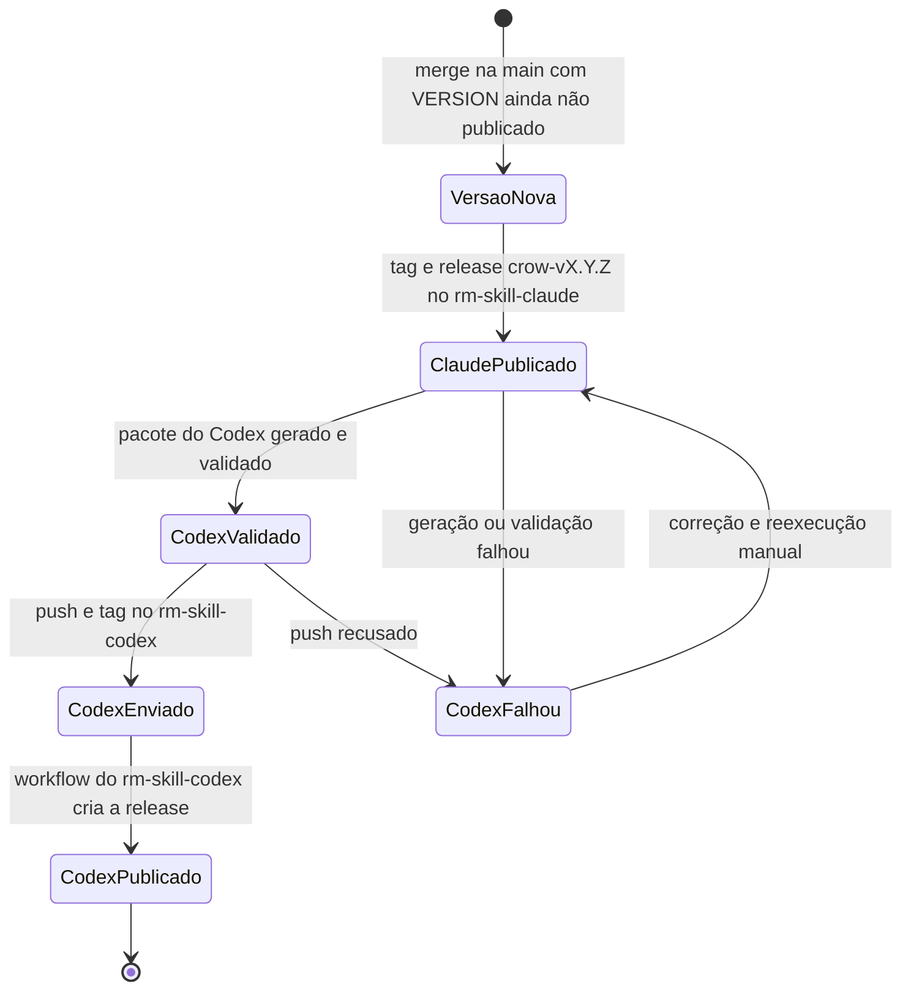
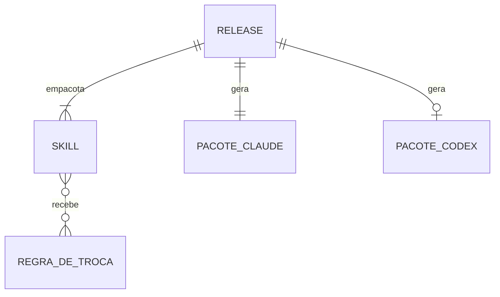
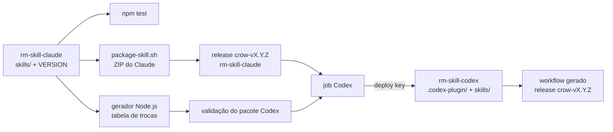
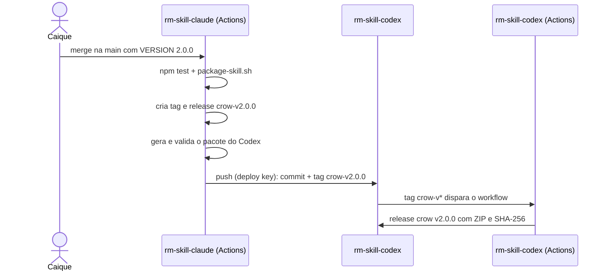
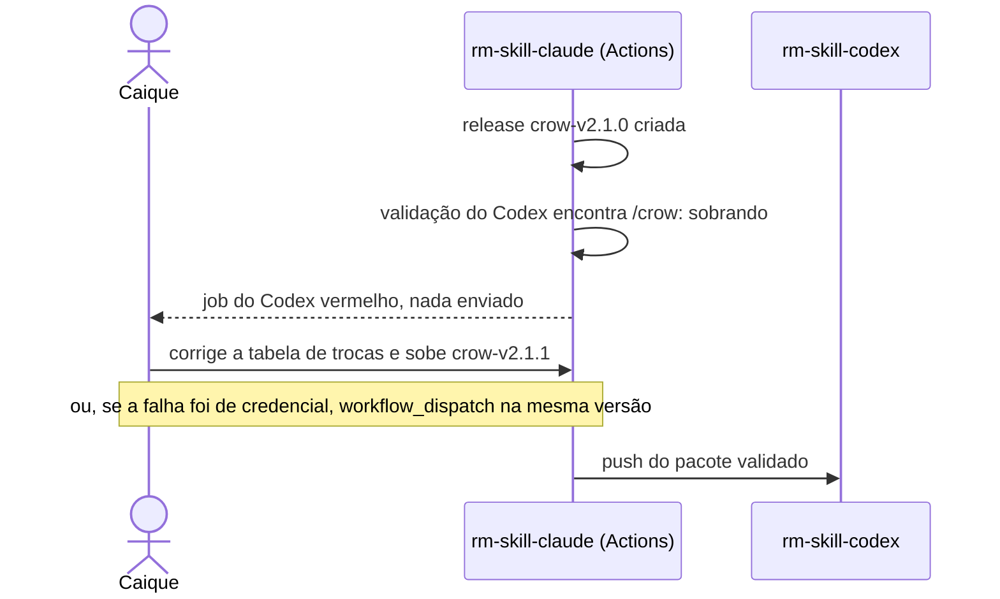

# crow executável no Codex

| | |
| --- | --- |
| Data | 2026-10-15 |
| Solicitante | Caique Rechi Mehret (pede, aprova e dá o aceite) |
| Cobertura do levantamento | 100% — 3 pontos técnicos a verificar no início do desenvolvimento |
| Status | Levantamento concluído |

## 1. Resumo

O plugin `crow` só roda no Claude Code. Quando os tokens do Claude acabam e o
trabalho continua no Codex, só a `conventions` existe lá, como uma skill avulsa
mantida à mão no repositório `rm-skill-codex`. O `rm-skill-codex` passa a ser
um **plugin do Codex chamado `crow`**, com as seis skills, **gerado
automaticamente** a partir do `rm-skill-claude`, que continua sendo a única
fonte. Cada release do `crow` publica a mesma versão nas duas ferramentas.

### 1.1 Objetivos

- **Continuar no Codex sem perder ferramenta.** Métrica: as seis skills
  (`context`, `conventions`, `analyst`, `develop`, `build`,
  `security-validation`) carregam e chegam ao mesmo resultado no Codex. Meta:
  6 de 6 no teste manual da 2.0.0.
- **Nunca editar duas vezes.** Métrica: alterações feitas à mão no
  `rm-skill-codex` fora da lista de arquivos intocados. Meta: zero.
- **Mesma versão nas duas ferramentas.** Métrica: o `VERSION` do
  `rm-skill-claude` é igual à versão do plugin publicado no `rm-skill-codex`.
  Meta: sempre igual, salvo enquanto uma publicação do Codex que falhou estiver
  esperando o reenvio (RN-07).

### 1.2 Situação atual

- `rm-skill-claude`: plugin `crow` 1.0.1 para o Claude Code, com seis skills,
  manifesto `.claude-plugin/plugin.json`, marketplace próprio, testes em
  Node.js e release automática com tag `crow-vX.Y.Z` e ZIP.
- `rm-skill-codex`: só a skill das convenções, versão 1.1.0, com tags
  `v1.0.0` a `v1.1.0`. A raiz do repositório é a própria skill (`SKILL.md` na
  raiz, `agents/openai.yaml`, `references/splitting-commits.md`), e a
  instalação é um clone em `~/.codex/skills/rm-skill-codex`. Release por
  `package-skill.ps1`. Tem uma `LICENSE` MIT.
- Comparação feita em 2026-10-15: o `SKILL.md` do Codex é igual ao
  `skills/conventions/SKILL.md` do `crow`, com duas diferenças: o título
  ("… for Codex") e a falta do bloco de regras inegociáveis. O
  `splitting-commits.md` é idêntico. A troca não perde nenhum conteúdo.
- **O que precisa sobreviver:** a `LICENSE`, as tags e releases `v1.x` já
  publicadas, e um caminho de migração para quem tem o clone antigo.

## 2. Partes interessadas e usuários

| Persona | Quantidade | Precisa de | Pode | Não pode |
| --- | --- | --- | --- | --- |
| Caique (autor e usuário) | 1 | as mesmas skills no Claude Code e no Codex, no mesmo projeto | editar a fonte, publicar, testar, dar o aceite | — |
| Workflow de release | 1 | publicar o pacote do Codex | fazer push no `rm-skill-codex` com a deploy key | escrever em qualquer outro repositório |

Quem aprova o escopo e aceita a entrega: Caique. Contexto de uso: Windows 11,
com Claude Code e Codex (app desktop) na mesma máquina, trocando de um para o
outro no meio de uma tarefa. Os dois repositórios são públicos, então outras
pessoas podem instalar, mas o plugin não é feito para elas.

## 3. Modelo de negócio

Não se aplica: é ferramenta de uso pessoal, sem cobrança. O ganho é não perder
o trabalho em andamento quando os tokens do Claude acabam.

## 4. Regras de negócio

### RN-01 — Uma fonte só

- **Regra:** as skills são editadas só no `rm-skill-claude`. O conteúdo do
  `rm-skill-codex` é gerado e nunca editado à mão.
- **Exemplo:** para mudar uma pergunta da `analyst`, edita-se
  `skills/analyst/SKILL.md` no `rm-skill-claude`. A próxima release leva a
  mudança para o Codex.
- **Exceção:** os arquivos da lista de intocados (RN-05).
- **Responsável pela regra:** Caique.

### RN-02 — Adaptação por substituição no gerador

- **Regra:** as skills do `crow` continuam escritas como são hoje. O gerador
  aplica uma tabela de trocas para o Codex. Se encontrar uma construção
  própria do Claude sem troca conhecida, **o build falha**.
- **Exemplo:** a tabela inicial, a confirmar na verificação (decisão 15.1):

  | No `crow` (Claude) | No Codex |
  | --- | --- |
  | `$ARGUMENTS` | texto dizendo que os argumentos são o que ele escreveu depois do nome da skill |
  | `/crow:<skill>` | o prefixo de chamada do Codex (`$<skill>` ou `$crow:<skill>`, a confirmar) |
  | `AskUserQuestion` | pergunta com opções numeradas em texto, recomendação primeiro |
  | `disable-model-invocation: true` | `agents/openai.yaml` com `policy.allow_implicit_invocation: false` |
  | sem `disable-model-invocation` (`conventions`) | `allow_implicit_invocation: true` |
  | `argument-hint` | descartado |
  | `.claude-plugin/` | `.codex-plugin/plugin.json` com `"skills": "./skills/"` |

- **Exceção:** um termo que aparece só como **referência** a outra
  ferramenta, sem ser uma instrução de uso (por exemplo, a `context` citando
  `CLAUDE.md` e `AGENTS.md`), não é trocado. A tabela precisa distinguir os
  dois casos.
- **Responsável pela regra:** Caique.

### RN-03 — Mesmo resultado, forma livre

- **Regra:** no Codex, cada skill segue as mesmas regras, na mesma ordem, e
  entrega os mesmos arquivos (`docs/requirements/`, `.context/`, relatórios de
  `docs/security/`, ambiente Docker). Onde o Codex não tem o recurso, a forma
  se adapta.
- **Exemplo:** a `analyst` no Codex continua com uma pergunta por mensagem,
  mas as opções aparecem numeradas em texto no lugar dos botões.
- **Exceção:** nenhuma skill fica de fora por falta de recurso. Se algo não
  tiver equivalente nem em forma adaptada, ele pergunta antes.
- **Responsável pela regra:** Caique.

### RN-04 — Mesma versão nas duas ferramentas

- **Regra:** o plugin do Codex usa sempre o `VERSION` do `rm-skill-claude`, e
  a tag é `crow-vX.Y.Z` nos dois repositórios. A primeira release conjunta é a
  **2.0.0**, nas duas ferramentas.
- **Exemplo:** `VERSION` = `2.0.0`. O Claude publica `crow-v2.0.0` no
  `rm-skill-claude` e o Codex publica `crow-v2.0.0` no `rm-skill-codex`.
- **Exceção:** as tags `v1.0.0` a `v1.1.0` do `rm-skill-codex` ficam como
  estão. A 2.0.0 foi escolhida para não ficar abaixo da 1.1.0 já publicada.
- **Responsável pela regra:** Caique.

### RN-05 — O gerador controla o `rm-skill-codex` inteiro

- **Regra:** cada publicação espelha o pacote gerado no `rm-skill-codex` e
  apaga o que não faz parte dele. Só não mexe nos itens de uma lista fixa,
  mantida no `rm-skill-claude`. O README e o workflow de release do Codex
  também são gerados.
- **Exemplo:** na 2.0.0 saem do `rm-skill-codex` o `SKILL.md` da raiz, o
  `agents/` da raiz, o `references/` da raiz e o
  `.github/scripts/package-skill.ps1`. A `LICENSE` fica.
- **Exceção:** lista de intocados: `LICENSE` (e o `.git`). Um item novo só
  entra nessa lista por decisão dele.
- **Responsável pela regra:** Caique.

### RN-06 — Publicação direta, sempre depois da validação (exceção à regra do push)

- **Regra:** o workflow publica no `rm-skill-codex` sem revisão humana, mas só
  depois de o pacote do Codex passar na validação estática (RF-03). É uma
  **exceção explícita** à convenção "o push é dele", e precisa ficar escrita
  na `conventions`.
- **Exemplo:** a release `crow-v2.0.1` gera o pacote, a validação passa e o
  workflow faz push e cria a tag no `rm-skill-codex`.
- **Exceção:** se a validação falha, nada é enviado ao `rm-skill-codex`. Fora
  desse workflow, a regra do push continua valendo, inclusive para qualquer
  agente que trabalhe nesses repositórios.
- **Responsável pela regra:** Caique.

### RN-07 — Uma falha do Codex não segura o Claude

- **Regra:** se a geração, a validação ou a publicação do Codex falharem, a
  release do `crow` para o Claude sai mesmo assim. O job do Codex fica
  vermelho no Actions e pode rodar de novo sozinho.
- **Exemplo:** a deploy key é removida por engano. Mesmo assim a
  `crow-v2.1.0` sai para o Claude, o job do Codex falha, ele corrige a chave e
  roda o workflow de novo (`workflow_dispatch`). O Codex recebe a 2.1.0 sem
  que a release do Claude seja recriada.
- **Exceção:** nenhuma.
- **Responsável pela regra:** Caique.

### RN-08 — Correção por versão nova

- **Regra:** uma release ruim nunca é corrigida reescrevendo uma tag. Sai uma
  versão nova (patch), nas duas ferramentas.
- **Exemplo:** a `crow-v2.0.0` chega ao Codex com uma troca errada. A correção
  sai como `crow-v2.0.1`.
- **Exceção:** nenhuma.
- **Responsável pela regra:** Caique.

### 4.9 Ciclo de vida de uma release

## 5. Requisitos funcionais

### RF-01 — Manifesto e marketplace do Codex

- **Persona:** Caique
- **Descrição:** o pacote gerado tem `.codex-plugin/plugin.json` com
  `name: crow`, a versão de `VERSION`, autor, descrição e
  `"skills": "./skills/"`, além do arquivo de marketplace que permite
  instalar o plugin a partir do `rm-skill-codex`.
- **Regras:** RN-04, RN-05
- **Critérios de aceite:**
  - Dado o `VERSION` 2.0.0, quando o pacote é gerado, então
    `.codex-plugin/plugin.json` declara `name: crow` e `version: 2.0.0`.
  - Dado o `rm-skill-codex` publicado, quando ele adiciona o marketplace e
    instala o `crow` no Codex, então as seis skills aparecem.
- **Prioridade:** MVP

### RF-02 — Gerador com tabela de trocas

- **Persona:** Caique
- **Descrição:** um script em Node.js no `rm-skill-claude` lê `skills/`,
  aplica a tabela de RN-02, gera um `agents/openai.yaml` por skill e escreve o
  pacote do Codex numa pasta de saída. `evals/`, `tests/` e `node_modules/`
  não entram.
- **Regras:** RN-01, RN-02, RN-03
- **Critérios de aceite:**
  - Dado `skills/build/SKILL.md` com `$ARGUMENTS`, quando o gerador roda,
    então a versão do Codex não contém `$ARGUMENTS` e explica de onde vêm os
    argumentos.
  - Dada uma skill com `disable-model-invocation: true`, quando o gerador
    roda, então ela ganha `agents/openai.yaml` com
    `allow_implicit_invocation: false`, e a `conventions` ganha `true`.
  - Dada uma construção do Claude sem troca na tabela, quando o gerador roda,
    então ele termina com erro e diz qual arquivo e qual trecho.
  - Dado o mesmo `skills/`, quando o gerador roda duas vezes, então a saída é
    idêntica byte a byte.
- **Prioridade:** MVP

### RF-03 — Validação estática do pacote do Codex

- **Persona:** Caique
- **Descrição:** antes de publicar, o pacote do Codex é conferido: o
  manifesto existe e é válido; o nome de cada pasta é igual ao `name:` do
  frontmatter; toda skill tem o bloco de regras inegociáveis; não sobra
  `$ARGUMENTS`, `/crow:`, `AskUserQuestion` nem `disable-model-invocation`
  como instrução; a versão é igual ao `VERSION`.
- **Regras:** RN-02, RN-04, RN-06
- **Critérios de aceite:**
  - Dada uma skill gerada com `/crow:analyst` no texto, quando a validação
    roda, então ela falha e nada é publicado.
  - Dado um PR no `rm-skill-claude`, quando o CI roda, então a validação do
    Codex roda num job próprio e o resultado aparece no PR.
- **Prioridade:** MVP

### RF-04 — Publicação no `rm-skill-codex`

- **Persona:** workflow de release
- **Descrição:** no job de release do `rm-skill-claude`, depois de criada a
  `crow-vX.Y.Z`, o workflow gera e valida o pacote, espelha o resultado no
  `rm-skill-codex` (apagando o que não pertence ao pacote, menos a lista de
  intocados), commita, faz push na `main` e envia a tag `crow-vX.Y.Z`, usando
  a deploy key. O job pode rodar sozinho por `workflow_dispatch`.
- **Regras:** RN-04, RN-05, RN-06, RN-07
- **Critérios de aceite:**
  - Dada uma versão nova na `main` do `rm-skill-claude`, quando o workflow
    termina, então o `rm-skill-codex` tem um commit com o pacote dessa versão
    e a tag `crow-vX.Y.Z`.
  - Dada uma falha no job do Codex, quando ele roda de novo por
    `workflow_dispatch`, então o Codex é publicado e a release do Claude não é
    recriada nem duplicada.
  - Dado um push que não muda o `VERSION`, quando o workflow roda, então nada
    é publicado no `rm-skill-codex`.
  - Dado que `rm-skill-codex` já tem a tag `crow-vX.Y.Z`, quando o job roda de
    novo, então ele termina sem erro e sem novo commit.
  - O commit gerado não tem `Co-Authored-By` nem outro trailer de autoria.
- **Prioridade:** MVP

### RF-05 — Release no `rm-skill-codex`

- **Persona:** workflow do `rm-skill-codex` (gerado)
- **Descrição:** o workflow do `rm-skill-codex`, também gerado a partir de um
  modelo no `rm-skill-claude`, roda quando chega uma tag `crow-v*` e cria a
  release com o ZIP do plugin e o checksum SHA-256.
- **Regras:** RN-04, RN-05
- **Critérios de aceite:**
  - Dada a tag `crow-v2.0.0` enviada pela deploy key, quando o workflow do
    `rm-skill-codex` roda, então existe a release `crow v2.0.0` com
    `crow-v2.0.0.zip` e `crow-v2.0.0.zip.sha256`.
- **Prioridade:** MVP

### RF-06 — README do Codex e migração do 1.x

- **Persona:** Caique
- **Descrição:** o README do `rm-skill-codex` é gerado com a instalação pelo
  marketplace do Codex, a tabela das seis skills com o prefixo de chamada do
  Codex, e a seção "Vindo do rm-skill-codex 1.x", que manda apagar
  `~/.codex/skills/rm-skill-codex` depois de instalar o plugin.
- **Regras:** RN-05
- **Critérios de aceite:**
  - Dado o README gerado, quando alguém segue a seção de migração, então não
    sobra skill antiga carregando ao lado do plugin.
- **Prioridade:** MVP

### RF-07 — Exceção do push escrita na `conventions`

- **Persona:** Caique
- **Descrição:** a `conventions` passa a registrar que o workflow de release do
  `crow` publica no `rm-skill-codex` sem revisão, depois da validação, e que
  essa é a única exceção à regra do push.
- **Regras:** RN-06
- **Critérios de aceite:**
  - Dada a `conventions` atualizada, quando um agente lê a regra do push,
    então encontra a exceção com o escopo exato (só esse workflow, só depois
    da validação).
- **Prioridade:** MVP

### RF-08 — Versão 2.0.0 nas duas ferramentas

- **Persona:** Caique
- **Descrição:** `VERSION` e `.claude-plugin/plugin.json` vão para 2.0.0 na
  primeira release conjunta.
- **Regras:** RN-04
- **Critérios de aceite:**
  - Dado o merge da 2.0.0, quando os workflows terminam, então existem
    `crow-v2.0.0` no `rm-skill-claude` e no `rm-skill-codex`.
- **Prioridade:** MVP

## 6. Requisitos não funcionais

| ID | Categoria | Requisito | Medida |
| --- | --- | --- | --- |
| RNF-01 | Segurança | a credencial de publicação só alcança o `rm-skill-codex` | deploy key SSH com escrita só nesse repositório, guardada como secret do `rm-skill-claude`; nenhum outro repositório aceita a chave |
| RNF-02 | Segurança | nenhum segredo vai para o pacote ou para o log | a validação falha se o pacote tiver um arquivo de `.env` ou uma chave privada; o workflow não imprime o secret |
| RNF-03 | Reprodutibilidade | a geração é determinística | duas execuções sobre o mesmo commit produzem saída idêntica (RF-02) |
| RNF-04 | Idempotência | reexecutar o job do Codex não duplica nada | rodar de novo sobre uma versão já publicada termina sem novo commit, tag ou release |
| RNF-05 | Conformidade | a licença do Codex continua valendo | `LICENSE` MIT preservada em toda publicação |
| RNF-06 | Idioma | os textos das skills ficam como na fonte | o gerador só troca os trechos da tabela, e o resto é copiado sem alteração |

Desempenho, concorrência, disponibilidade, escalabilidade e acessibilidade: não
se aplicam. É um pipeline de release de uso pessoal, rodado algumas vezes por
mês.

## 7. Modelo de domínio e dados

### 7.1 Entidades

| Entidade | Atributos principais | Origem | Volume (dia / 5 anos) |
| --- | --- | --- | --- |
| Skill | pasta, `name`, `description`, invocação implícita sim/não, arquivos de apoio | `rm-skill-claude/skills/` | 6 hoje |
| Regra de troca | padrão do Claude, substituto no Codex, se é instrução ou referência | gerador no `rm-skill-claude` | dezenas |
| Lista de intocados | caminhos no `rm-skill-codex` | `rm-skill-claude` | 1 item hoje (`LICENSE`) |
| Release | versão, tag, ZIP, checksum | `VERSION` | algumas por mês |

### 7.2 Relacionamentos

### 7.3 Histórico, retenção e migração

Não se aplica como dado de negócio: o histórico é o git dos dois repositórios
e as releases do GitHub. Migração: o conteúdo atual do `rm-skill-codex` é
substituído pelo pacote gerado. O que tinha lá já existe no `crow` (seção
1.2). As tags e releases `v1.x` ficam.

## 8. Arquitetura

### 8.1 Visão geral

O `rm-skill-claude` é a única fonte. O gerador é uma etapa do build, não um
serviço. O `rm-skill-codex` vira um repositório de saída, como uma pasta
`dist/` publicada. Tudo roda no GitHub Actions. Nada roda no navegador.

### 8.2 Tecnologias

| Camada | Tecnologia | Motivo |
| --- | --- | --- |
| Gerador e validação | Node.js 22 | o repositório já usa Node 22 nos testes e no `package-skill.sh` |
| Testes do gerador | `node:test` em `tests/` | mesmo padrão dos testes atuais |
| Leitura de frontmatter | `js-yaml` (já é dependência de desenvolvimento) | evita parser próprio |
| Pipeline | GitHub Actions (`release.yml` existente) | já publica o `crow` |
| Formato no Codex | plugin com `.codex-plugin/plugin.json` e `skills/` | formato visto nos plugins instalados no Codex desta máquina |

Descartados: manter os dois repositórios à mão (é como divergem); reescrever as
skills de forma neutra na fonte (mudaria as seis skills do Claude); arquivos de
ajuste por skill (tendem a divergir); publicar por PR (ele escolheu publicação
direta, depois da validação).

### 8.3 Integrações

| Sistema | Direção | Gatilho | Contrato | Se falhar |
| --- | --- | --- | --- | --- |
| `rm-skill-codex` (GitHub) | `rm-skill-claude` → `rm-skill-codex` | release nova do `crow` | push por SSH com deploy key: commit na `main` e tag `crow-vX.Y.Z` | job vermelho; o Claude já saiu; reexecução manual (RN-07) |
| GitHub Releases do `rm-skill-codex` | tag → release | push da tag `crow-v*` | `gh release create` com o `GITHUB_TOKEN` do próprio repositório | workflow vermelho no `rm-skill-codex`; reexecução manual |

Credenciais: a deploy key é do Caique. A parte privada fica como secret do
`rm-skill-claude`, e a pública fica cadastrada no `rm-skill-codex` com
permissão de escrita. Não expira. Sem custo.

### 8.4 Multiempresa, ambientes e deploy

Multiempresa não se aplica. Ambientes: desenvolvimento local (gerar o pacote e
carregar no Codex instalado na máquina dele) e "produção", que é o
`rm-skill-codex` publicado. Deploy: release do `crow` → job do Codex → tag no
`rm-skill-codex` → release lá. Reversão: sempre uma versão nova (RN-08).

## 9. Fluxos principais

### 9.1 Release normal

### 9.2 Falha do Codex e reenvio

## 10. Gargalos, riscos e mitigações

| Risco | Onde | Probabilidade | Impacto | Mitigação |
| --- | --- | --- | --- | --- |
| O formato do marketplace do Codex num repositório ou o prefixo de chamada de skill de plugin não serem os esperados | RF-01, RN-02 | média | alto: o plugin não instala, ou as chamadas `$x` nos textos ficam erradas | verificar na documentação oficial e no Codex instalado antes de escrever o gerador (decisões 15.1 e 15.2) |
| Uma troca correta no texto, mas que muda o sentido da skill | RN-02 | média | médio: a skill carrega e se comporta diferente | o build falha em construção desconhecida; teste manual das seis skills na 2.0.0; refazer o teste quando a tabela mudar |
| Publicação sem revisão leva um erro do gerador ao Codex | RN-06 | baixa | médio | validação estática bloqueia; correção por patch (RN-08) |
| Claude e Codex com versões diferentes depois de uma falha | RN-07 | baixa | baixo | job vermelho e reexecução por `workflow_dispatch` |
| Push por deploy key não disparar o workflow do `rm-skill-codex` | RF-05 | baixa | médio: release do Codex não sai | verificar no início (decisão 15.3); se não disparar, decidir com ele outra forma de criar a release |
| Termo do Claude que é referência (como `CLAUDE.md` na `context`) sendo trocado por engano | RN-02 | média | médio | a tabela distingue instrução de referência; teste com a `context` |
| Clone antigo em `~/.codex/skills/rm-skill-codex` carregando junto com o plugin | RF-06 | baixa (não está instalado nesta máquina) | baixo | seção de migração no README gerado |
| Ponto único de falha: a deploy key | RN-07 | baixa | baixo | Claude não depende dela; troca da chave documentada |

## 11. Escopo e fases

- **MVP (2.0.0):** RF-01 a RF-08, com as seis skills: `context`,
  `conventions`, `analyst`, `develop`, `build` e `security-validation`.
- **Fase 2:** nenhuma definida.
- **Fora do escopo:** evals automáticos rodando dentro do Codex (`codex exec`)
  no CI; outras ferramentas (Cursor, Gemini, Copilot), que continuam atendidas
  só pelo `AGENTS.md`/`GEMINI.md` da `context`; publicar por PR; mudar o texto
  das skills do Claude para ficarem neutras.

## 12. Engenharia e operação

- **Equipe:** Caique.
- **Repositório e processo:** convenções do `/crow:conventions`: branch
  `cm-…`, um commit por alteração, em inglês, sem coautoria, push dele. Única
  exceção: o push automático do workflow de release no `rm-skill-codex`
  (RN-06), que precisa ser registrado na `conventions` (RF-07).
- **Testes:** testes do gerador e da validação em `tests/*.test.mjs` com
  `node:test`, cobrindo cada troca da tabela, a falha em construção
  desconhecida, a idempotência e a geração do `openai.yaml`. O `npm test`
  continua rodando em todo PR.
- **CI/CD:** `release.yml` do `rm-skill-claude` ganha um job de validação do
  Codex em PR e um job de publicação depois da release do Claude, que pode
  rodar sozinho por `workflow_dispatch`. O `release.yml` do `rm-skill-codex`
  passa a ser gerado.
- **Documentação:** seção Codex no README do `crow` e `docs/codex.md` com a
  tabela de trocas e a lista de intocados, cada um num commit `docs:` próprio.
  README do `rm-skill-codex` gerado. Roteiro do teste manual em
  `docs/testing.md`.
- **Monitoramento:** o job vermelho no GitHub Actions, com a notificação de
  falha do GitHub.
- **Backup:** o git dos dois repositórios e as releases.
- **Suporte:** Caique.
- **Implantação:** release 2.0.0. Migração do clone antigo pela seção do
  README.

## 13. Restrições

- **Prazo:** sem prazo fixo. Sai quando o teste manual passar.
- **Orçamento:** zero. GitHub Actions em repositório público e deploy key sem
  custo.
- **Organizacionais:** não se aplica.

## 14. Aceite

- **Estático, a cada release:** `npm test` e a validação do pacote do Codex
  passam no CI.
- **Manual, na 2.0.0:** ele instala o `crow` pelo marketplace do
  `rm-skill-codex` no Codex desta máquina e chama cada uma das seis skills uma
  vez, seguindo o roteiro de `docs/testing.md`:
  - `context`: `prepare` num projeto de teste cria só os arquivos que faltam;
    `save` e `resume` funcionam.
  - `conventions`: carrega sozinha antes de um commit.
  - `analyst`: faz uma pergunta por mensagem, com opções numeradas, e retoma
    de um `HANDOFF.md`.
  - `develop`: lê um documento de `docs/requirements/` e para no fim da fase.
  - `build`: `status` responde sem subir nada.
  - `security-validation`: roda sobre o fixture `php-app` e escreve o
    relatório em `docs/security/`.
- O teste manual se repete só quando a tabela de trocas mudar.
- **Quem assina:** Caique, com base no CI verde e no roteiro preenchido em
  `docs/testing.md`.

## 15. Decisões em aberto

Nenhuma decisão de escopo ficou em aberto. Três pontos técnicos precisam ser
verificados no começo do desenvolvimento, porque o resultado muda o gerador:

| # | Decisão | Área | Responsável | Prazo | Impacto se atrasar |
| --- | --- | --- | --- | --- | --- |
| 15.1 | Prefixo de chamada de uma skill que vem de plugin no Codex (`$analyst` ou `$crow:analyst`) e se `$ARGUMENTS` tem algum equivalente | Regras / Tecnologias | `/crow:develop`, confirmado com Caique | antes de escrever a tabela de trocas | as referências entre skills ficam erradas |
| 15.2 | Arquivo e caminho do marketplace do Codex dentro de um repositório, e o comando de instalação | Tecnologias | `/crow:develop`, confirmado com Caique | antes do RF-01 | o plugin não instala |
| 15.3 | Se o push de uma tag por deploy key dispara o workflow do `rm-skill-codex` | Integrações | `/crow:develop`, confirmado com Caique | antes do RF-05 | a release do Codex não é criada |

## 16. Glossário

| Termo | Significado |
| --- | --- |
| `crow` | o plugin de skills do Caique; o mesmo nome no Claude Code e no Codex |
| `rm-skill-claude` | repositório fonte do `crow` e marketplace do Claude Code |
| `rm-skill-codex` | repositório de saída, com o `crow` gerado para o Codex |
| Gerador | script Node.js que transforma `skills/` do Claude no pacote do Codex |
| Tabela de trocas | lista de construções do Claude e seus substitutos no Codex |
| Lista de intocados | arquivos do `rm-skill-codex` que o gerador não altera nem apaga |
| Deploy key | chave SSH com escrita em um único repositório |
| Invocação implícita | o modelo carregar a skill sozinho, sem ele chamar pelo nome |
