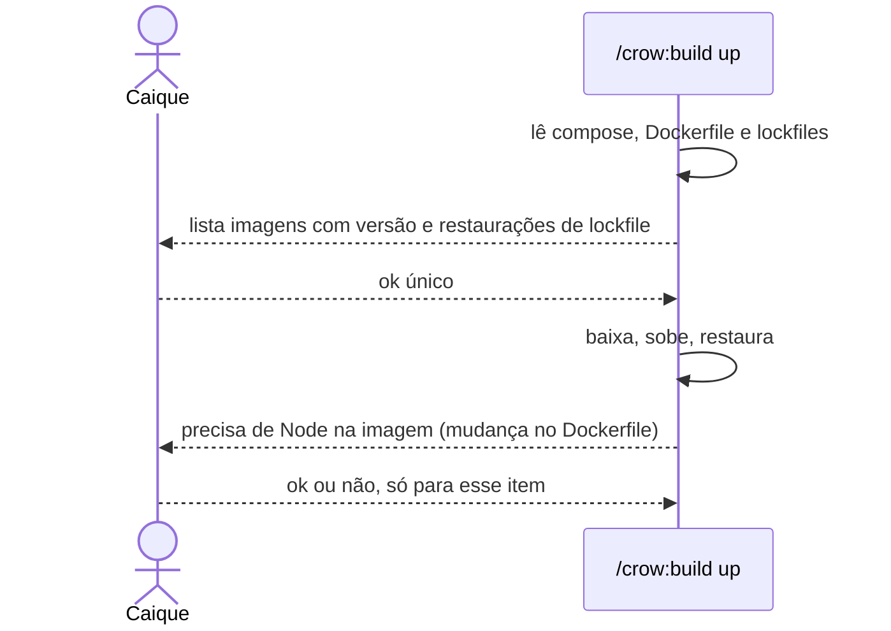
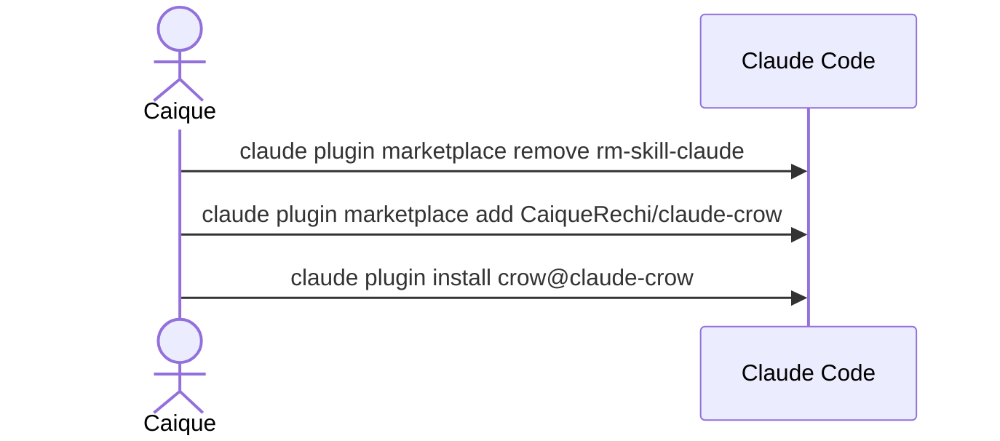

# Revisão do claude-crow — Fase 0

| | |
| --- | --- |
| Data | 2026-10-20 |
| Solicitante | Caique Rechi Mehret (pede, aprova e dá o aceite) |
| Cobertura do levantamento | 100% — 0 decisões em aberto |
| Status | Levantamento concluído |

## 1. Resumo

O relatório de revisão do `claude-crow` (2026-10-20, revisão `a820490`)
propôs uma Fase 0 de correções. Este documento cobre três delas: um nome
canônico para repositório, marketplace e plugin; um nome honesto para o teste
de referências externas; e uma política de instalação e download idêntica na
`develop` e na `build`. As fases de tokens, deduplicação e avaliação
comportamental ficam para outras entrevistas.

### 1.1 Objetivos

- **Uma identidade só.** Métrica: ocorrências de `rm-skill-claude` em arquivos
  rastreados fora das exceções de RN-02. Meta: zero, conferido por teste.
- **Instalação pelos comandos novos.** Métrica: instalação limpa com
  `CaiqueRechi/claude-crow` e `crow@claude-crow`. Meta: funciona.
- **Uma política de instalação.** Métrica: o bloco é igual na `develop` e na
  `build`. Meta: igual, conferido por teste.

### 1.2 Situação atual

Vista no `origin/main` em `a820490`:

- O repositório foi renomeado para `CaiqueRechi/claude-crow`; o nome antigo
  redireciona.
- `rm-skill-claude` aparece em `.claude-plugin/marketplace.json` (nome do
  marketplace), `.claude-plugin/plugin.json` (`repository`), `package.json`
  (`name`), no título e nos comandos de instalação do README, na seção "Vindo
  do rm-skill-claude 1.x" e num trecho histórico de `docs/testing.md`.
- Erro no README: a instalação por release no PowerShell adiciona
  `"$HOME\plugins\rm-skill-claude"`, mas o ZIP extrai a pasta `crow`.
- O `origin` do clone local ainda é `https://github.com/CaiqueRechi/rm-skill-claude.git`.
- `tests/security-rules.test.mjs:91` se chama "every external reference was
  verified", mas só confere se cada identificador está em
  `catalog/references.md`.
- A `develop` pede ok item a item até para restaurar um lockfile ou baixar uma
  imagem. A `build` roda `docker compose up -d --build` e instala as
  dependências sem pedir nada; só o preparo do WSL e o Node na imagem pedem
  ok.

## 2. Partes interessadas e usuários

| Persona | Quantidade | Precisa de | Pode | Não pode |
| --- | --- | --- | --- | --- |
| Caique | 1 | instalar e atualizar o `crow` por um nome só; saber o que a skill vai baixar | aprovar a lista de um `up`, aprovar cada item novo | — |
| Agente rodando `develop` ou `build` | 1 | uma regra só para downloads | baixar o que está declarado depois do ok único; pedir item a item o que é novo | baixar qualquer coisa sem o ok dele |

## 3. Modelo de negócio

Não se aplica: é ferramenta pessoal.

## 4. Regras de negócio

### RN-01 — Modelo de nomes

- **Regra:** o repositório e o marketplace se chamam `claude-crow`; o plugin
  continua `crow`. A instalação é
  `claude plugin marketplace add CaiqueRechi/claude-crow` e
  `claude plugin install crow@claude-crow`. As tags continuam `crow-vX.Y.Z`.
- **Exemplo:** `.claude-plugin/marketplace.json` com `"name": "claude-crow"`;
  `plugin.json` com `"repository": "https://github.com/CaiqueRechi/claude-crow"`;
  `package.json` com `"name": "claude-crow"`; título do README `# claude-crow`.
- **Exceção:** o `rm-skill-codex` fica de fora desta fase.
- **Responsável pela regra:** Caique.

### RN-02 — Onde o nome antigo ainda pode aparecer

- **Regra:** `rm-skill-claude` só aparece nas seções de migração do README
  ("Vindo do rm-skill-claude 1.x" e "Vindo do marketplace rm-skill-claude"),
  no trecho histórico de `docs/testing.md` e nestes documentos de requisitos e
  rastreabilidade, que registram a migração.
- **Exemplo:** um `crow@rm-skill-claude` esquecido num comando de instalação
  faz o teste falhar.
- **Exceção:** `package-lock.json` acompanha o `name` do `package.json` e é
  regerado, não editado à mão.
- **Responsável pela regra:** Caique.

### RN-03 — Migração de quem já instalou

- **Regra:** a seção "Vindo do marketplace rm-skill-claude" ensina:
  `claude plugin marketplace remove rm-skill-claude`,
  `claude plugin marketplace add CaiqueRechi/claude-crow`,
  `claude plugin install crow@claude-crow`.
- **Exemplo:** quem instalou a 1.1.0 por `crow@rm-skill-claude` segue os três
  comandos e passa a receber a 1.2.0.
- **Exceção:** a seção "Vindo do rm-skill-claude 1.x" (skill clonada em
  `~/.claude/skills`) continua como está.
- **Responsável pela regra:** Caique.

### RN-04 — Política única de instalação e download

- **Regra:** vale igual na `develop` e na `build`.
  - **Restaurar o que o projeto já declara pede um ok único**, com a lista
    antes: as imagens com versão fixa citadas no compose e no `FROM` do
    Dockerfile, e cada restauração de lockfile (`composer install`, `npm ci`,
    `pip install -r` a partir do arquivo travado).
  - **O que é novo pede ok item a item**, com versão, origem e motivo:
    dependência nova, imagem nova, troca de versão, mudança no Dockerfile,
    scaffolding (`composer create-project`, `npx create-…`), ferramenta global,
    pacote de sistema, runtime e download avulso.
- **Exemplo:** num `up` de um projeto Laravel, a `build` lista `mysql:8.4`,
  `php:8.3-apache`, `composer:2`, `composer install` do `composer.lock` e
  `npm ci` do `package-lock.json`, e pede um ok só. Se a suíte precisar de
  Node na imagem, isso é uma mudança no Dockerfile e é pedido à parte.
- **Exceção:** o preparo do WSL e o Node na imagem já pedem ok passo a passo,
  e continuam pedindo, por serem casos do segundo grupo. Um "não" vale: a
  skill segue sem o item, ou diz que o requisito está bloqueado.
- **Responsável pela regra:** Caique.

### RN-05 — Uma fonte para o texto da política

- **Regra:** o texto da política mora num arquivo em `.github/` (como
  `.github/non-negotiable-rules.md`) e entra literal na `develop` e na `build`.
  O empacotamento ou um teste recusa a skill cujo bloco divergir.
- **Exemplo:** editar uma palavra do bloco só na `build` faz o CI falhar.
- **Exceção:** nenhuma.
- **Responsável pela regra:** Caique.

### RN-06 — O teste diz o que faz

- **Regra:** "every external reference was verified" passa a se chamar "every
  external reference is present in the verified catalog". O comportamento não
  muda.
- **Exemplo:** quem lê o resultado do CI sabe que é uma conferência interna do
  catálogo, e não um download das fontes oficiais.
- **Exceção:** o job de manutenção que baixaria os artefatos e conferiria os
  hashes fica para depois.
- **Responsável pela regra:** Caique.

## 5. Requisitos funcionais

### RF-01 — Trocar a identidade para claude-crow

- **Persona:** Caique
- **Descrição:** aplicar RN-01 em `marketplace.json`, `plugin.json`,
  `package.json` (nome e descrição, com o `package-lock.json` regerado) e no README: título,
  comandos de instalação, links de release e o caminho do PowerShell, que
  passa a ser `"$HOME\plugins\crow"`.
- **Regras:** RN-01, RN-02
- **Critérios de aceite:**
  - Dado o `main` novo, então `marketplace.json` declara `claude-crow` e
    `plugin.json` aponta para `https://github.com/CaiqueRechi/claude-crow`.
  - Dado o README, então toda instalação usa `CaiqueRechi/claude-crow` e
    `crow@claude-crow`, e a instalação por release no PowerShell adiciona
    `"$HOME\plugins\crow"`.
- **Prioridade:** MVP

### RF-02 — Seção de migração

- **Persona:** Caique
- **Descrição:** RN-03 no README.
- **Regras:** RN-03
- **Critérios de aceite:**
  - O README tem "Vindo do marketplace rm-skill-claude" com os três comandos.
- **Prioridade:** MVP

### RF-03 — Teste contra o nome antigo

- **Persona:** Caique
- **Descrição:** um teste em `tests/` falha se `rm-skill-claude` aparecer num
  arquivo rastreado fora das exceções de RN-02.
- **Regras:** RN-02
- **Critérios de aceite:**
  - Dado um `crow@rm-skill-claude` fora das seções de migração, então o teste
    falha e diz o arquivo e a linha.
  - Dado o repositório depois do RF-01, então o teste passa.
- **Prioridade:** MVP

### RF-04 — Política de instalação idêntica

- **Persona:** agente
- **Descrição:** escrever RN-04 em `.github/`, substituir a seção "Nothing is
  installed without his explicit consent" da `develop` pelo bloco, inserir o
  mesmo bloco na `build` e ajustar o passo "Start and prepare" da `build` para
  listar e pedir o ok único antes de baixar.
- **Regras:** RN-04
- **Critérios de aceite:**
  - Dado um `up`, então a `build` lista imagens e lockfiles e não baixa nada
    antes do ok.
  - Dada uma dependência nova na `develop`, então ela pede ok com versão,
    origem e motivo.
  - Dada a restauração de um lockfile na `develop`, então ela pede um ok
    único, com a lista.
- **Prioridade:** MVP

### RF-05 — Conferência do bloco

- **Persona:** Caique
- **Descrição:** RN-05: o `package-skill.sh` ou um teste confere que a
  `develop` e a `build` contêm o bloco literal do arquivo em `.github/`.
- **Regras:** RN-05
- **Critérios de aceite:**
  - Dado o bloco alterado só numa das skills, então o CI falha.
  - Dado o pacote de release, então `.github/installation-policy.md` está
    presente e os links de `docs/build.md` e `docs/develop.md` funcionam.
- **Prioridade:** MVP

### RF-06 — Renomear o teste de referências

- **Persona:** Caique
- **Descrição:** RN-06.
- **Regras:** RN-06
- **Critérios de aceite:**
  - `npm test` mostra "every external reference is present in the verified
    catalog" passando.
- **Prioridade:** MVP

### RF-07 — Versão, documentação e origin local

- **Persona:** Caique
- **Descrição:** `VERSION` e `plugin.json` em 1.2.0; documentação atualizada
  (`docs/develop.md`, `docs/build.md`, `docs/testing.md`); `origin` local
  apontando para `https://github.com/CaiqueRechi/claude-crow.git`, como
  configuração local, sem commit.
- **Regras:** RN-01, RN-04
- **Critérios de aceite:**
  - `npm test` e as validações do `package-skill.sh` passam.
  - A release sai como `crow-v1.2.0`.
- **Prioridade:** MVP

## 6. Requisitos não funcionais

Não se aplicam: não há desempenho, carga, disponibilidade nem dados
envolvidos. A única exigência de segurança é RN-04: nada é baixado sem o ok
dele.

## 7. Modelo de domínio e dados

Não se aplica.

## 8. Arquitetura

### 8.1 Visão geral

Não muda. A política entra como mais um bloco literal conferido no CI, ao lado
de `.github/non-negotiable-rules.md`.

### 8.2 Tecnologias

As mesmas: Markdown, Node `node:test`, bash no empacotamento, GitHub Actions.

### 8.3 Integrações

Não se aplica. O GitHub já redireciona o nome antigo; esta fase deixa de
depender disso.

### 8.4 Multiempresa, ambientes e deploy

Não se aplica. A release é a `crow-v1.2.0`, pelo workflow atual.

## 9. Fluxos principais

### 9.1 `up` com a política nova

### 9.2 Quem já instalou

## 10. Gargalos, riscos e mitigações

| Risco | Onde | Probabilidade | Impacto | Mitigação |
| --- | --- | --- | --- | --- |
| Quem instalou por `crow@rm-skill-claude` deixa de receber atualizações | RN-01 | média | médio | seção de migração (RF-02); o redirecionamento do GitHub segue funcionando para o `add` antigo |
| O ok único virar um carimbo, aprovado sem ler | RN-04 | média | médio | a lista traz cada imagem com versão e cada lockfile; item novo continua à parte |
| O teste do nome antigo pegar uma citação legítima | RF-03 | baixa | baixo | as exceções de RN-02 são explícitas |
| Comandos de marketplace diferentes do esperado no Claude Code | RF-07 | baixa | médio | a instalação limpa do aceite confere |

## 11. Escopo e fases

- **MVP (1.2.0):** RF-01 a RF-07.
- **Depois (outras entrevistas):** o resto do relatório — tokens e núcleo da
  `conventions` (F-02), deduplicação das regras (F-05), contexto (F-06),
  leitura por fase na `develop` (F-07), modo compacto da `analyst` (F-08),
  perfis de ambiente (F-09), cerimônia das convenções (F-11), avaliação
  comportamental (F-01), medição de tokens de referência e o job de
  manutenção das referências.
- **Fora do escopo:** o `rm-skill-codex`, e o aceite da `build` 1.1.0, que já
  está pendente com ele.

## 12. Engenharia e operação

Convenções do `/crow:conventions`: branch `cm-…` a partir da `main`, um commit
por mudança, em inglês, sem coautoria, documentação no último commit. O push
é dele, salvo quando ele pedir. CI atual: `npm test` mais o `package-skill.sh`.

## 13. Restrições

Sem prazo e sem custo.

## 14. Aceite

- O teste contra o nome antigo (RF-03) passa.
- O teste da política idêntica (RF-05) passa, e o teste renomeado (RF-06)
  aparece no `npm test`.
- Uma instalação limpa com `claude plugin marketplace add CaiqueRechi/claude-crow`
  e `claude plugin install crow@claude-crow`, num diretório de configuração
  separado para não tocar a instalação dele, mostra o `crow` 1.2.0 com as
  seis skills.
- Quem assina: Caique.

## 15. Decisões em aberto

Nenhuma.

## 16. Glossário

| Termo | Significado |
| --- | --- |
| Marketplace | o catálogo de plugins que o Claude Code adiciona; aqui, `claude-crow` |
| Restaurar | baixar o que o projeto já declara e travou (lockfile, imagem com versão fixa) |
| Ok único | uma aprovação para a lista inteira do que será restaurado num `up` |
